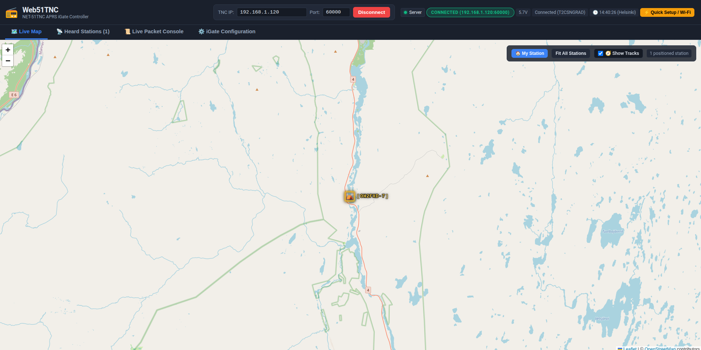
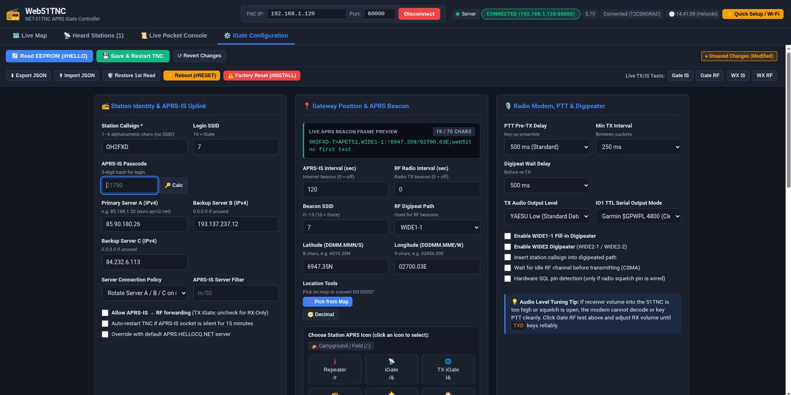
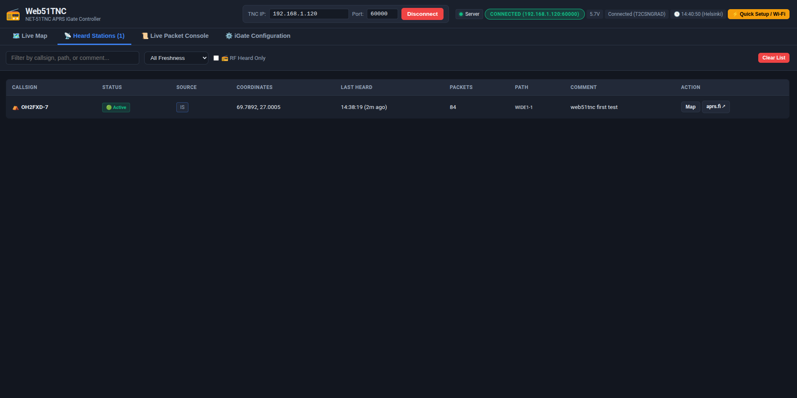
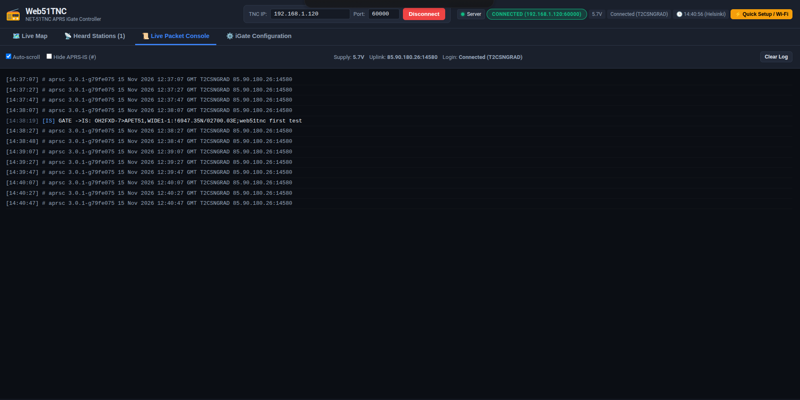

# Web51TNC — APRS Gateway & Controller for NET-51TNC

[](LICENSE)
[](https://python.org)

**Web51TNC** is a modern, responsive web controller, real-time packet monitor, and live Leaflet.js map for the **NET-51TNC / APRS 51TNC** hardware TNC / iGate / digipeater device (popularly used with Wouxun, Baofeng, and Kenwood VHF transceivers).

It completely replaces the legacy Windows .NET configuration software with a cross-platform Python service and browser interface suitable for standalone Raspberry Pi setups.

---

## 📸 Screenshots

| Live Map | iGate Configuration |
| :---: | :---: |
|  |  |

| Heard Stations | Live Packet Console |
| :---: | :---: |
|  |  |

---

## 📸 Key Features

* 🗺️ **Tactical HUD Live Leaflet Map**:
  * Plots all heard APRS stations in real-time with transparent tactical HUD reticles, bracketed callsigns (`[N0CALL-7]`), visual APRS symbol icons, and popups.
  * **Always-Visible Home Gateway Marker**: Plots your own TNC iGate position from EEPROM and automatically centers on it at startup.
  * **2-Hour Live Retention & Track Breadcrumbs**: Keeps the map focused on live/recent stations (2h window) with an optional **`🧭 Show Tracks`** toggle for mobile station movement polylines.
  * **Interactive Location Picker (`📍 Pick from Map`)**: Click directly on the map to set your exact Gateway coordinates in both APRS (`DDMM.MMN/DDDMM.MME`) and decimal formats.
  * **Automatic Country Timezone**: Detects your station's country timezone from its coordinates and ITU callsign prefix, displaying all map popups, Heard Stations rows, and Packet Console logs in 24-hour local time (`HH:MM:SS`).
* ⚡ **Quick Station & Wi-Fi Provisioning Wizard (`⚡ Quick Setup / Wi-Fi`)**:
  * Auto-opens on first boot or in Hotspot AP mode (and accessible anytime from the top bar).
  * Configures **Callsign**, **Auto-Calculated APRS-IS Passcode**, **SSID Role Flag (`-7` Handheld, `-9` Mobile, `-10` iGate, `-13` Weather, `-5` Home)**, **Visual APRS Icon**, **Coordinates**, and **Raspberry Pi Wi-Fi Uplink** in one screen.
* 📡 **Automatic Field Wi-Fi Hotspot AP Fallback (`Web51TNC-Setup`)**:
  * On boot, `web51tnc-wifi-fallback.service` waits up to 45 seconds for a known Wi-Fi network. If none is in range, the Raspberry Pi automatically opens a WPA2 Hotspot AP **`Web51TNC-Setup`** (password: `web51tnc`) at **`http://10.42.0.1:8000`** (`http://web51tnc.local:8000`).
* 💾 **Zero Flash-Wear Architecture**:
  * Live heard stations and tracks are persisted in RAM (`/dev/shm/web51tnc_stations.json` on `tmpfs`), and EEPROM backups on disk are only written when the 512-byte configuration actually changes — protecting SD cards and USB sticks during 24/7 operation.
* ⚙️ **Full 512-Byte Hardware EEPROM Configuration**:
  * Complete support for Station Identity, Ethernet IP/Mask/Gateway, APRS-IS Servers (`rotate` / `always_a`), 20-tile visual APRS icon selector, Radio Modem (PTT delay, TX level, 1200/9600 modes), Digipeater (`WIDE1-1` / `WIDE2-2`), Weather Beacon, and GPS IO2 Tracker.
  * Reliable W5100/8051 EEPROM write cycle (holds TCP socket open during MCU flash before reboot supervision).

---

## 🔌 Hardware & Appliance Architecture

```
                                      +------------------------+
                                      |   Wouxun / VHF Radio   |
                                      +------------------------+
                                                  | Audio / PTT
                                                  v
+------------------------+  Direct Ethernet   +------------------------+
|      Raspberry Pi      |<==================>|       NET-51TNC        |
| eth0: 192.168.1.1/24   |   Auto-MDIX RJ45   | 192.168.1.120 : 60000  |
| DHCP + nftables NAT    |                    | Gateway: 192.168.1.1   |
+------------------------+                    +------------------------+
            |
   wlan0 Wi-Fi Uplink
   (or Hotspot AP 10.42.0.1)
            |
            v
+------------------------+
| Browser UI / Phone/ PC |
| http://web51tnc.local:8000
+------------------------+
```

### Runtime Services on the Raspberry Pi Appliance
| Unit / Script | Role |
| :--- | :--- |
| `web51tnc.service` | FastAPI + Uvicorn web controller & TCP 60000 supervisor (`:8000`) |
| `web51tnc-dhcp.service` | `dnsmasq` DHCP server bound strictly to `eth0` (`192.168.1.50–.110`, router `.1`) |
| `web51tnc-nat.service` | `nftables` IPv4 masquerade routing `192.168.1.0/24` (`eth0`) through `wlan0` |
| `web51tnc-wifi-fallback.service` | Boot watchdog (`/usr/local/sbin/web51tnc-ap-ctl`) that starts Hotspot AP `Web51TNC-Setup` (`10.42.0.1`) if no client Wi-Fi connects within 45s |
| `web51tnc-firstboot.service` | One-shot first-boot provisioner (`/usr/local/sbin/web51tnc-firstboot.sh`), logs progress to `/boot/firmware/STATUS.TXT` |

See [HARDWARE_SETUP.md](HARDWARE_SETUP.md) for full wiring pinouts and radio settings.

---

## 🚀 Quick Start & Installation

### Option A: Offline Raspberry Pi USB / SD Image Provisioner (Zero-Touch Appliance)

Bake a complete dual-homed APRS appliance directly into a stock Raspberry Pi OS Lite (Bookworm or Trixie 64-bit) `.img` or `.img.xz` file **before** flashing — no root privileges needed for image customization:

```bash
# 1. Provision with your Wi-Fi credentials pre-configured:
./rpi/provision-usb-image.sh \
  --image rpi/build/raspios-lite-arm64.img.xz \
  --ssid "YourWiFi" \
  --ssid-alt "YourWiFi_5G" \
  --psk "YourWiFiPassword" \
  --hostname web51tnc \
  --country FI

# OR provision a generic field image (boots straight into Hotspot AP 'Web51TNC-Setup'):
./rpi/provision-usb-image.sh --image rpi/build/raspios-lite-arm64.img.xz

# 2. Flash to USB stick or SD card (unmount partitions first):
sudo ./rpi/provision-usb-image.sh --image rpi/build/raspios-lite-arm64.img --flash /dev/sdX
```

What `provision-usb-image.sh` does offline (using `sfdisk`, `e2fsck`, `resize2fs`, `debugfs`, and `mtools`):
1. Pre-expands the root partition offline to 4 GiB and removes the `cmdline.txt` first-boot `resize` hook + adds USB storage quirks (`usbcore.autosuspend=-1`) so USB sticks boot reliably without power-spike brownouts.
2. Configures both `userconf.txt` and Trixie `cloud-init` (`user-data` / `meta-data`) + unlocks SSH (`ssh.service`).
3. Writes NetworkManager `.nmconnection` profiles (`0600`), disables Wi-Fi powersave, and clears all `rfkill` soft-blocks.
4. Stages the full `web51tnc-bundle` into `/boot/firmware/web51tnc-bundle` and enables `web51tnc-firstboot.service` + `web51tnc-wifi-fallback.service`.
5. Verifies every file, permission, and ext4 filesystem structure before finishing.

#### Flashing the Image (Linux, macOS & Windows)

Whether you download a pre-built `.img.xz` from [GitHub Releases](https://github.com/oh2fxd/web51tnc/releases) or build one locally with `provision-usb-image.sh`:

> [!IMPORTANT]
> If flashing with **Raspberry Pi Imager**, choose **Operating System → Use custom** and select **No** when asked to apply OS customization settings — the Web51TNC image already includes first-boot provisioning, SSH, and Wi-Fi/Hotspot configuration.

* **Linux**:
  * **GUI**: Use **Raspberry Pi Imager** or **balenaEtcher** and select the `.img.xz` / `.img` file.
  * **CLI**: Unmount any auto-mounted partitions on the target drive (`/dev/sdX`), then flash:
    ```bash
    # Using the built-in flasher (uncompressed .img):
    sudo ./rpi/provision-usb-image.sh --image rpi/build/raspios-lite-arm64.img --flash /dev/sdX

    # Or directly from .img.xz with dd:
    xzcat web51tnc-rpi.img.xz | sudo dd of=/dev/sdX bs=4M status=progress conv=fsync
    sync
    ```
* **macOS**:
  * **GUI**: Use **Raspberry Pi Imager** or **balenaEtcher** (handles `.img.xz` directly).
  * **CLI**: Identify your USB/SD disk with `diskutil list`, unmount it, and write to the raw `/dev/rdiskN` device:
    ```bash
    diskutil unmountDisk /dev/diskN
    xzcat web51tnc-rpi.img.xz | sudo dd of=/dev/rdiskN bs=4m
    sync
    diskutil eject /dev/diskN
    ```
* **Windows**:
  * **GUI**: Download **Raspberry Pi Imager**, **balenaEtcher**, or **Rufus**, select the `.img.xz` (or extracted `.img`) file, pick your USB stick or SD card, and click **Write / Flash**.
  * Once flashed, insert the USB stick or SD card into the Raspberry Pi, connect Ethernet to the NET-51TNC, and power on. On first boot, connect to **`http://web51tnc.local:8000`** (or join the **`Web51TNC-Setup`** Wi-Fi hotspot, password `web51tnc`, and open **`http://10.42.0.1:8000`**).

---

### Option B: Automated Installer (Existing Raspberry Pi & Linux)

Clone the repository and run the automated installer:

```bash
git clone https://github.com/oh2fxd/web51tnc.git
cd web51tnc
./install.sh
```

The installer will:
1. Verify Python 3.10+ and install all required packages (`fastapi`, `uvicorn`, `pydantic`, `websockets`).
2. Offer to automatically configure and start the background **systemd service** (`web51tnc.service`) tied to your username and path.
3. Offer to add a non-destructive secondary Ethernet IP alias (`192.168.1.50/24`) on `eth0` via NetworkManager for direct plug-and-play connection to the default `192.168.1.120` TNC IP.

To install completely non-interactively with background service enabled:
```bash
./install.sh -y
```

To uninstall the systemd service:
```bash
sudo ./install.sh --uninstall
```

---

### Option C: Manual Setup

1. Install dependencies:
   ```bash
   pip install -r requirements.txt
   ```

2. Assign an IP in the same subnet (`192.168.1.x`) to your Ethernet interface:
   ```bash
   sudo ip addr add 192.168.1.50/24 dev eth0
   sudo ip link set eth0 up
   ```

3. Launch Web51TNC:
   ```bash
   ./run.sh
   # Or directly with custom options:
   python3 server.py --host 0.0.0.0 --port 8000 --tnc-ip 192.168.1.120
   ```

Open your browser at **`http://localhost:8000`** (or `http://<pi-ip>:8000`).

---

## ⚙️ Command-Line & Daemon Configuration

`server.py` supports the following CLI arguments and environment variables:

| Argument | Environment Variable | Default | Description |
| :--- | :--- | :--- | :--- |
| `--host` | `HOST` | `0.0.0.0` | IP/Interface to bind web server |
| `--port` | `PORT` | `8000` | Web interface port |
| `--tnc-ip` | `TNC_IP` | `192.168.1.120` | NET-51TNC target IP address |
| `--tnc-port` | `TNC_PORT` | `60000` | NET-51TNC target TCP port |
| `--no-auto-connect` | `AUTO_CONNECT=0` | Enabled | Disable background auto-reconnect worker |
| `--reload` | — | Disabled | Enable uvicorn auto-reload (development only) |

### Headless Raspberry Pi Auto-Reconnect
By default, Web51TNC runs an autonomous background supervisor that continually maintains a link to the NET-51TNC. If the TNC reboots or the cable is disconnected, Web51TNC reconnects automatically and re-polls configuration without requiring browser interaction.

---

## 🛠️ Service Management

If installed as a systemd daemon:

```bash
# Check status
sudo systemctl status web51tnc

# View live streaming logs
sudo journalctl -u web51tnc -f

# Restart or stop
sudo systemctl restart web51tnc
sudo systemctl stop web51tnc
```


---

## 📖 Documentation & Technical References

* **[PROTOCOL.md](PROTOCOL.md)**: Reverse-engineered protocol specification, 512-byte EEPROM memory map, Big-Endian timer structure, and firmware history (2012–2017).
* **[HARDWARE_SETUP.md](HARDWARE_SETUP.md)**: Radio cable wiring, Kenwood 2-pin connector pinout, receiver volume squelch tuning, and hardware recovery jumper.
* **[REVERSE_ENGINEERING_GUIDE.md](REVERSE_ENGINEERING_GUIDE.md)**: Walkthrough of the reverse engineering workflow, toolchain (`dnfile`, `dncil`, `stcgal`, `radare2`, `srecord`), and automated analyzer tool (`tools/re_tnc_analyzer.py`).
* **[docs/APRS_51TNC_MANUAL_20160310_BH4TDV.pdf](docs/APRS_51TNC_MANUAL_20160310_BH4TDV.pdf)**: Official 2016 hardware manual with schematics and expansion pinouts.
* **[docs/APRS_51TNC_FAQ.pdf](docs/APRS_51TNC_FAQ.pdf)**: Official author technical FAQ and troubleshooting notes.
* **[docs/BH4TDV_CHANGELOG.txt](docs/BH4TDV_CHANGELOG.txt)**: Full author firmware release notes (2012–2017) recovered from binary resource heaps.

---

## 🙏 Credits & Original Creator

* **Hardware & Firmware**: **BH4TDV** — original creator and developer of the **NET-51TNC / APRS 51TNC** hardware, firmware, and Windows configuration utility (`BH4TDV/APRS-51TNC`). All reverse-engineered protocol findings, 512-byte EEPROM layout details, and recovered official documentation/changelogs are published in this repository for the amateur radio community.
* **Web51TNC & Protocol Reverse-Engineering**: **Mikko / OH2FXD** ([github.com/oh2fxd/web51tnc](https://github.com/oh2fxd/web51tnc)).

---

## 💬 Feedback & Issues

Found a bug, firmware quirk, or have a feature request? Please open an issue or leave a comment on **[GitHub Issues](https://github.com/oh2fxd/web51tnc/issues)** — feedback from different 51TNC hardware revisions and firmware versions is especially welcome!

---

## 📄 License


This project is licensed under the [MIT License](LICENSE).

---

## ☕ Support & Sponsorship

If you find this project helpful:

[](https://github.com/sponsors/oh2fxd)
[](https://www.paypal.com/paypalme/dxdroid)

- **GitHub Sponsors**: [github.com/sponsors/oh2fxd](https://github.com/sponsors/oh2fxd)
- **PayPal**: [paypal.me/dxdroid](https://www.paypal.com/paypalme/dxdroid) — 73 de OH2FXD
