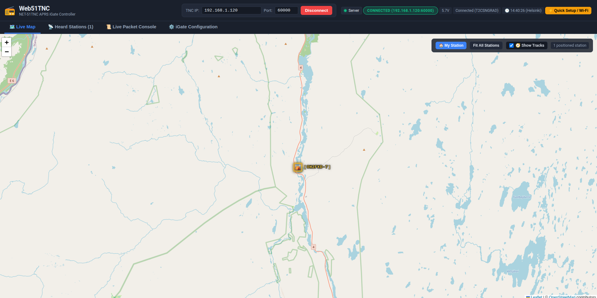
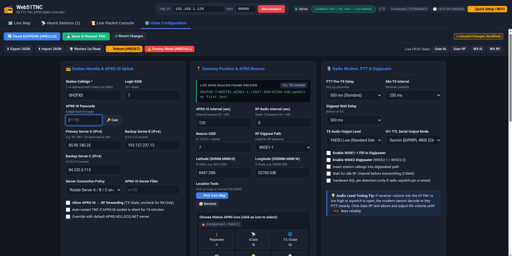

# Web51TNC v1.1.0 — Release Notes

**Web51TNC** is an open-source, cross-platform web controller, live Leaflet.js tactical APRS map, and Raspberry Pi appliance for the **NET-51TNC / APRS 51TNC** hardware TNC / iGate / digipeater.

Repository: [github.com/oh2fxd/web51tnc](https://github.com/oh2fxd/web51tnc)

| Live Map | iGate Configuration |
| :---: | :---: |
|  |  |

---

## Highlights in v1.1.0

* **Tactical HUD Live Leaflet Map**: Real-time APRS station plotting, 2-hour live retention, optional track breadcrumbs, interactive `📍 Pick from Map` coordinate selector, and automatic local timezone detection.
* **Quick Station & Wi-Fi Provisioning Wizard**: One-screen setup for callsign, auto-calculated APRS-IS passcode, SSID role, icon, coordinates, and Raspberry Pi Wi-Fi uplink.
* **Zero-Touch Raspberry Pi Appliance (`rpi/`)**:
  * Offline image provisioner (`rpi/provision-usb-image.sh`) for Raspberry Pi OS Lite (Bookworm / Trixie 64-bit).
  * Automatic `Web51TNC-Setup` Wi-Fi Hotspot AP fallback (`10.42.0.1:8000`) if no known Wi-Fi network is in range within 45s.
  * Direct `eth0` DHCP + `nftables` NAT (`192.168.1.1/24` ↔ TNC `192.168.1.120:60000`) and zero flash-wear RAM station persistence (`/dev/shm`).
* **Full Protocol Findings & Source Published**:
  * Complete 512-byte EEPROM memory map, Big-Endian `uint16` beacon timer findings, TCP `60000` framing, and GPS `E0`–`E9` codes in [`PROTOCOL.md`](PROTOCOL.md).
  * Reverse-engineering walkthrough and CIL analyzer (`tools/re_tnc_analyzer.py`) in [`REVERSE_ENGINEERING_GUIDE.md`](REVERSE_ENGINEERING_GUIDE.md).
  * Radio wiring, squelch tuning, and IO3+IO4 hardware reset guide in [`HARDWARE_SETUP.md`](HARDWARE_SETUP.md).
  * Official BH4TDV 2016 manual, FAQ, and recovered firmware changelog (`2012–2017`) under [`docs/`](docs/).

---

## Installing the Raspberry Pi Image (Linux, macOS & Windows)

> **Important (Raspberry Pi Imager)**: Choose **Operating System → Use custom** and select **No** when prompted to apply OS customization settings — the Web51TNC image already has first-boot provisioning, SSH, and Wi-Fi/AP fallback configured.

* **Linux**: Use **Raspberry Pi Imager** / **balenaEtcher**, or flash via CLI:
  ```bash
  xzcat web51tnc-rpi.img.xz | sudo dd of=/dev/sdX bs=4M status=progress conv=fsync
  sync
  ```
* **macOS**: Use **Raspberry Pi Imager** / **balenaEtcher**, or flash via CLI:
  ```bash
  diskutil unmountDisk /dev/diskN
  xzcat web51tnc-rpi.img.xz | sudo dd of=/dev/rdiskN bs=4m
  sync
  diskutil eject /dev/diskN
  ```
* **Windows**: Use **Raspberry Pi Imager**, **balenaEtcher**, or **Rufus** to write the `.img.xz` (or extracted `.img`) to your USB stick or SD card.

After booting the Pi, open **`http://web51tnc.local:8000`** (or connect to Wi-Fi **`Web51TNC-Setup`** with password `web51tnc` and open **`http://10.42.0.1:8000`**).

---

## Credits & Original Creator

* **BH4TDV** — Original creator and developer of the **NET-51TNC / APRS 51TNC** hardware, firmware, and Windows setup utility (`BH4TDV/APRS-51TNC`).
* **Mikko / OH2FXD** — Web51TNC software, Raspberry Pi appliance, and protocol reverse-engineering.

---

## Feedback & Issues

If you run into any issues, have a different 51TNC hardware/firmware revision, or want to share feedback, please leave a comment or open an issue at:
**[github.com/oh2fxd/web51tnc/issues](https://github.com/oh2fxd/web51tnc/issues)**

---

## Support & Sponsorship

If you find this project helpful:

[](https://github.com/sponsors/oh2fxd)
[](https://www.paypal.com/paypalme/dxdroid)

* **GitHub Sponsors**: [github.com/sponsors/oh2fxd](https://github.com/sponsors/oh2fxd)
* **PayPal**: [paypal.me/dxdroid](https://www.paypal.com/paypalme/dxdroid) — 73 de OH2FXD
